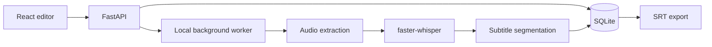

# clipscribe-local

Local-first subtitles for Greek and other languages. The v0.1.0 goal is a local pipeline that transcribes a video, lets you review and correct timed words, and exports readable SRT subtitles.

> Day 1 scaffold. Setup instructions, measured benchmarks, and supported hardware will be filled in as they are verified. No benchmark results are claimed yet.

## Status

Core library in progress: audio extraction, word-timed transcription, and subtitle segmentation. See [Roadmap](docs/ROADMAP.md) and [LEARNINGS.md](LEARNINGS.md).

## Development setup

Prerequisites for the current audio pipeline: Git, 64-bit Python 3.11–3.14, and FFmpeg on `PATH`. Python 3.14 has Windows wheels for CTranslate2, PyAV, and ONNX Runtime. The project pins PyAV below 19 because PyAV 19 changed an API that the current faster-whisper release still uses. CUDA 12 and cuDNN 9 are needed for faster-whisper GPU inference; without them the code falls back to CPU int8. Docker Desktop and Node.js are needed in later steps, not for this library code.

```powershell
# Run these commands from the clipscribe-local repository root.
python -m venv .venv
.\.venv\Scripts\Activate.ps1
python -m pip install --upgrade pip
python -m pip install -e ".[dev]"
ffmpeg -version
python -m pytest
```

To exercise the current library code from a Python shell:

```python
from pathlib import Path
from clipscribe.audio import extract_audio
from clipscribe.transcription import transcribe
from clipscribe.segmenter import segment_words

audio_path = extract_audio(Path("input.mp4"), Path("work/input.wav"))
result = transcribe(audio_path, model_name="small", language="el")
words = tuple(word for segment in result.segments for word in segment.words)
for cue in segment_words(words):
    print(cue.start, cue.end, cue.text)
```

The first transcription downloads the selected model to the faster-whisper cache. Once downloaded, transcription can run offline. A web app and direct run command are not available yet; the HTTP API and editor arrive later in the plan.

## Architecture



## Evaluation data

The planned initial benchmark uses 8 locally selected Greek utterances from Mozilla Common Voice Scripted Speech. The corpus has not been downloaded or checked yet. Follow `benchmarks/corpus/README.md` for the official source, listening checks, and local-only data rules. The Mozilla Data Collective listing says the dataset is CC0-1.0 and also forbids re-hosting or re-sharing it, so the downloaded archive, extracted audio, and source transcript rows must stay out of Git. Benchmark setup therefore requires a separate official download and is not ready from a clean clone. This read-speech sample does not represent spontaneous video speech.

## Benchmarks

No measurements yet. Results will be recorded from real runs in `benchmarks/RESULTS.md`; the benchmark script will report real-time factor and WER for the selected models.

## Limitations

Not measured yet. Greek accuracy, hardware needs, and failure cases such as names, slang, and noisy audio will be documented from actual testing before v0.1.0.

## Roadmap

See [docs/ROADMAP.md](docs/ROADMAP.md). Items there are planned follow-up work and are not part of v0.1.0.
