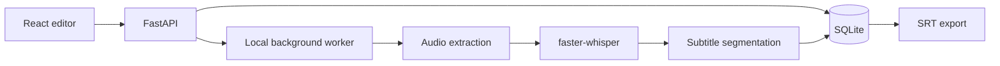

# clipscribe-local

Local-first subtitles for Greek and other languages. The v0.1.0 goal is a local pipeline that transcribes a video, lets you review and correct timed words, and exports readable SRT subtitles.

> Day 1 scaffold. Setup instructions, measured benchmarks, and supported hardware will be filled in as they are verified. No benchmark results are claimed yet.

## Status

Planning and repository setup. See [Roadmap](docs/ROADMAP.md) and [LEARNINGS.md](LEARNINGS.md).

## Development setup

Prerequisites: Git, Python 3.11 or 3.12 (dependency compatibility will be checked before choosing), Node.js LTS, and Docker Desktop for the later container workflow.

```powershell
git clone <repository-url>
cd clipscribe-local
py -3.11 -m venv .venv
.\.venv\Scripts\Activate.ps1
python -m pip install --upgrade pip
```

The project dependencies and first runnable command will be added in the relevant implementation steps. This scaffold does not yet claim to run the application.

## Architecture



## Evaluation data

The planned initial benchmark uses 8 locally selected Greek utterances from Mozilla Common Voice Scripted Speech. The corpus has not been downloaded or checked yet. Follow `benchmarks/corpus/README.md` for the official source, listening checks, and local-only data rules. The Mozilla Data Collective listing says the dataset is CC0-1.0 and also forbids re-hosting or re-sharing it, so the downloaded archive, extracted audio, and source transcript rows must stay out of Git. Benchmark setup therefore requires a separate official download and is not ready from a clean clone. This read-speech sample does not represent spontaneous video speech.

## Benchmarks

No measurements yet. Results will be recorded from real runs in `benchmarks/RESULTS.md`; the benchmark script will report real-time factor and WER for the selected models.

## Limitations

Not measured yet. Greek accuracy, hardware needs, and failure cases such as names, slang, and noisy audio will be documented from actual testing before v0.1.0.

## Roadmap

See [docs/ROADMAP.md](docs/ROADMAP.md). Items there are planned follow-up work and are not part of v0.1.0.
