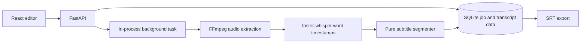

# clipscribe-local

Local-first subtitles for Greek and other languages. Upload a video, review the word-timed transcript in your browser, correct it, and export readable SRT subtitles. The video and transcript stay on your computer.

## Status

The local backend, upload flow, transcript editor, SRT export, and segmentation are implemented. A real-video run and benchmark numbers are still pending a suitable sample file. See [Roadmap](docs/ROADMAP.md) and [LEARNINGS.md](LEARNINGS.md).

## Quick Start

### Windows, without Docker

Install FFmpeg and Node.js 24 once, then double-click `start-local.cmd`. On its first run, it prepares the Python and web packages; after that it opens the app at [http://localhost:5173](http://localhost:5173). Two terminal windows stay open while the app runs; close both to stop it. Python 3.14 is supported.

### Docker Desktop

After the repository has been published to GitHub, clone it and start the local app:

```powershell
git clone https://github.com/<your-account>/clipscribe-local.git
cd clipscribe-local
docker compose up --build
```

Open [http://localhost:8080](http://localhost:8080). The API documentation is at [http://localhost:8000/docs](http://localhost:8000/docs).

Docker Desktop must be installed and running. The default `large-v3-turbo` Whisper model downloads on first transcription into the `clipscribe-models` volume; once downloaded, the app can transcribe offline. User videos and SQLite data live in the separate `clipscribe-data` volume. The model is not included in the image. You can select another faster-whisper model by setting `CLIPSCRIBE_MODEL` before starting the app.

The clone URL above needs the GitHub account name that will own the public repository. The current local repository has no Git remote yet.

## Development setup

Prerequisites: Git, 64-bit Python 3.11–3.14, FFmpeg, and Node.js 24. Python 3.14 works with the current CTranslate2 and PyAV wheels. PyAV is pinned below 19 because the current faster-whisper release calls an API removed in PyAV 19. GPU inference requires compatible NVIDIA CUDA and cuDNN libraries; if CUDA setup fails, transcription falls back to CPU int8.

```powershell
# In the repository root:
python -m venv .venv
.\.venv\Scripts\Activate.ps1
python -m pip install --upgrade pip
python -m pip install -e ".[dev]"
ffmpeg -version
python -m pytest
ruff check .
mypy src
```

Start the API and frontend in separate terminals:

```powershell
# Repository root; leave this terminal running.
uvicorn clipscribe.main:app --reload --host 127.0.0.1 --port 8000
```

```powershell
cd frontend
npm ci
npm run dev
```

Open [http://localhost:5173](http://localhost:5173) for the development UI. The Vite dev server proxies API requests to port 8000.

The default transcription model is `large-v3-turbo`, which is more capable than `small` while keeping inference fast on a supported GPU. The model is downloaded on first use. For a higher-accuracy, slower alternative, select `large-v3` before starting the Windows launcher:

```powershell
$env:CLIPSCRIBE_MODEL = "large-v3"
.\start-local.cmd
```

The choice is configurable because accuracy and speed depend on the recording; review and correct the transcript before exporting.

## Fonts

Style 2.0 self-hosts Manrope and JetBrains Mono through Fontsource. Both font packages include Greek and Latin subsets and use the SIL Open Font License; the license copies ship in `frontend/public/licenses/`.

## Architecture



## Evaluation data

The benchmark runner reads a local TSV manifest containing `audio_path` and hand-checked `reference` columns. See `benchmarks/corpus/README.md` for the intended Common Voice Greek source, access steps, and local-only data rules. Mozilla Data Collective permits computational use under CC0 but forbids re-hosting or re-sharing its dataset, so the downloaded archive, audio, and source transcript rows stay out of Git. This corpus is scripted read speech and does not represent spontaneous creator video speech.

After creating `benchmarks/corpus/local/sample.tsv`, run:

```powershell
python benchmarks/run.py --models tiny,base,small --device auto --output benchmarks/local-results.md
```

## Benchmarks

No measurements yet. `benchmarks/run.py` reports WER and real-time factor per model. It excludes model loading and first-run downloads from RTF. Add results only after running it against checked references, and include the machine, compute mode, and model settings.

## Limitations

Greek accuracy has not been measured on this project’s sample yet. Names, slang, code-switching, overlapping speakers, music, and noisy audio can reduce transcription quality. The default background task runs inside the API process; a process restart can interrupt queued work. The app is intended for one user on one computer and has no login or multi-user controls. Docker Compose uses CPU inference by default; GPU acceleration depends on the host's NVIDIA runtime and compatible CUDA/cuDNN libraries.

## Roadmap

See [docs/ROADMAP.md](docs/ROADMAP.md). Items there are planned follow-up work and are not part of v0.1.0.
